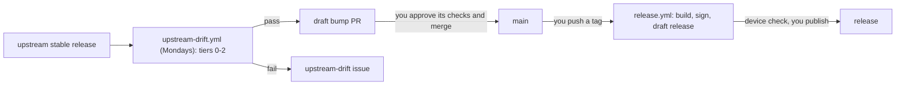

# Releasing

A new upstream stable release reaches a draft GitHub release through two steps of yours:

1. Merge the bump PR.
2. Push a tag.

Publishing waits for a check on a Fire TV.



## The bump PR

Every Monday, `.github/workflows/upstream-drift.yml` checks upstream's latest stable release.
If it is newer than `PINNED_REF` in `scripts/build.sh` (a different tag of the same version
counts too), the workflow runs tiers 0-2 against it, using `main`'s patches and pins. An older
"latest" (a pulled upstream release, or a `main` bumped by hand past it) proposes nothing.

**Pass:** the bot opens a draft PR from `bot/upstream-bump`, titled
"Update to Tailscale <version>". The PR changes only `PINNED_REF`.

1. **Start its checks.** GitHub holds the PR's CI runs for approval, because a workflow opened
   the PR. Select **Approve workflows to run** in the merge box within 30 days (after that the
   held runs expire), or close and reopen the PR: `gh pr close <n> && gh pr reopen <n>`.
   Either one runs the normal PR checks.
2. **When they pass,** mark the PR ready and merge it (`gh pr ready <n>`, then
   `gh pr merge <n> --squash`).

How the bot manages the PR:

- There is one bump PR at a time. A newer passing release force-pushes the branch and retitles
  the PR, so don't push your own commits there. Its checks are held again: repeat step 1.
- If you close a bump PR unmerged, the bot does not propose that version again. To bring it
  back, reopen the PR while it is still the newest bump, or bump by hand (see the next section).
- Once `main` pins the latest release or a newer one, through the bot or by hand, the bot closes
  any open bump PR.
- **A red `bump` job** in a Monday run means the bot could not push or open the PR. The same
  run closes the drift issue, so this is the only signal. Read the job's log:
  - **`refusing to allow … workflow`:** `main` changed a workflow file since the bot branch
    was last pushed.
    1. Delete the bot branch: `git push origin --delete bot/upstream-bump`. This also closes
       an open bump PR, whose older version the new one supersedes.
    2. Re-run the failed job: `gh run rerun <run-id> --failed`. The bot then pushes a fresh
       branch and opens a new PR.
  - **Any other error:** just re-run the failed job, `gh run rerun <run-id> --failed`. Do not
    delete the branch: the PR may already carry the new version.
- **The `ts_ref` input** of a manual run is a test hook. It bypasses the downgrade guard and
  proposes the given release as the bump, even an older one, from the branch the run is on: it
  pushes that branch plus the bump to `bot/upstream-bump`, so it opens, updates or closes the
  real bump PR. Use it only when no real bump PR is open. The drift issue changes only on a run
  from `main` without it; a run from another branch without it at most tests the release.

**Fail:** the `upstream-drift` issue opens, or gets a comment when a newer release fails. It
closes once a later release passes, or once `main` pins the release or a newer one.

## When the bot cannot bump

The failing run's log names the cause. Tier 0 stops at the first of these:

- `needs new toolchain pins; set these lines in scripts/build.sh:` — paste the printed
  `NAME=value` lines.
- `patch does not apply to <ref>: <patch>` — rebase that patch (BUILD.md, "`TS_REF` and the
  patch series").
- `stream JSON decode called in …` — extend 0005.

In tier 1 or 2, fix the build, lint or emulator failure.

If the issue says resolving the upstream release failed, no tier ran. The `resolve` job's log
names the cause: an upstream tag in an unexpected format, no `PINNED_REF=` line in
`scripts/build.sh`, or a failed GitHub API call (re-run it).

To fix it:

1. On your own branch, set `PINNED_REF` to the release and make the fixes.
2. Run the tiers ([TESTING.md](TESTING.md)).
3. Open a PR.

After it merges, the next Monday run closes the issue.

## Cutting a release

Once the bump is on `main` and `main`'s CI is green:

```sh
git fetch origin
git tag 1.104.6-fireos5-r1 origin/main
git push origin 1.104.6-fireos5-r1
```

Tags are `<upstream version>-fireos5-r<N>`. N starts at 1 for each upstream version. It goes up
when a fix in this repo needs a new release of the same version.

`.github/workflows/release.yml` then:

1. Builds armeabi-v7a with `make build`, which includes `verify-apk` and the versionCode check.
2. Re-signs the APK with the release key from the repo secrets.
3. Writes the `.sha256`.
4. Creates a **draft** release. Its notes list the upstream version, the checksum, the signing
   certificate and the patches.

It refuses:

- a tag that is not in that format
- a tag that names a version other than `PINNED_REF`'s
- a tag that is not on `main`
- a tag that already has a release, draft or published
- a signature by any key other than `CERT_SHA256` in `scripts/sign-apk.sh`

## Publishing

1. Download the draft's APK and `.sha256` (`gh release download <tag> -D <dir>`), then run
   `shasum -a 256 -c <apk>.sha256` in `<dir>`.
2. Run [TESTING.md, "Before a release"](TESTING.md#before-a-release-hardware-only) on a Fire TV.
3. Replace the notes' leading comment with what you verified, then publish, in the web UI or
   with `gh release edit <tag> --draft=false`.
4. If the device check fails:
   1. Delete the draft and its tag:
      `gh release delete <tag> --yes --cleanup-tag; git tag -d <tag>`.
   2. Fix the problem in a PR, then tag again. Nothing was published, so the same tag name is
      fine.

## When a release run fails

- **`Build` failed:**
  - If the failure was transient (a runner or network flake), re-run it:
    `gh run rerun <run-id> --failed`. That also re-runs `Sign and draft the release`.
  - Otherwise:
    1. Fix the cause through a PR.
    2. Delete the tag: `git push origin :refs/tags/<tag>; git tag -d <tag>`.
    3. Tag again.
- **`Sign and draft the release` failed:**
  1. If it left a draft, delete it: `gh release delete <tag> --yes`.
  2. Re-run the failed job within 7 days, while the built APK is kept:
     `gh run rerun <run-id> --failed`.

## Setup (once)

- **Signing secrets:** `TS_KEYSTORE_BASE64`, `TS_KEYSTORE_PASSWORD` and `TS_KEY_ALIAS`
  ([STATUS.md, "Signing"](STATUS.md#signing)).
- **Let the bot open PRs:**
  1. Go to Settings › Actions › General › Workflow permissions.
  2. Tick **Allow GitHub Actions to create and approve pull requests**.
  3. Save.
  4. Leave "Read repository contents and packages permissions" selected.

  CLI form:
  `gh api -X PUT repos/{owner}/{repo}/actions/permissions/workflow -f default_workflow_permissions=read -F can_approve_pull_request_reviews=true`.

  The bot still cannot make its own PR start CI; you approve its checks (see "The bump PR").

## Reproducibility

To rebuild a release, run `git checkout <tag> && make build`. A tag pins the upstream commit
(`PINNED_REF`), the toolchain pins and `patches/`. The versionCode comes from the upstream
commit time, so a rebuild has the same versionCode.

The bytes differ between builds, because of Gradle's dependency resolution and signing. So
compare `scripts/verify-apk.py` output rather than hashes, and check the certificate with
`apksigner verify --print-certs`.
